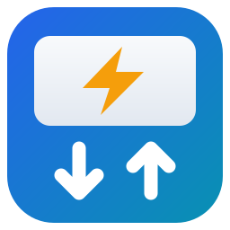

# inexogy for Home Assistant

Unofficial Home Assistant integration for smart meters read out by
[inexogy](https://inexogy.com). It uses the same API as the inexogy web portal.

## Sensors

One device per meter found in the measurement series, named `inexogy <meter serial>`.
Meters that appear later are added automatically.

| Sensor | Unit | Notes |
| --- | --- | --- |
| Grid consumption | kWh | Meter reading (import), `total_increasing` – usable in the Energy dashboard |
| Grid feed-in | kWh | Meter reading (export), `total_increasing` – usable in the Energy dashboard |
| Grid consumption power | W | Average import power of the latest 15-minute interval |
| Grid feed-in power | W | Average export power of the latest 15-minute interval |
| Net grid power | W | Import minus export (negative while exporting) |
| Last measurement | timestamp | End of the latest interval delivered by the portal |

### Diagnostic statistics (disabled by default)

The meter device also carries diagnostic sensors about the communication with the
portal (listed under *Diagnostic* on the device page). They are disabled by default;
enable them if you want the numbers (e.g. to tune polling). API calls are made per
container, so with several meters in one container they sit on the first meter.

| Sensor | Meaning |
| --- | --- |
| API calls | Every HTTP request to the portal (login, refresh, data) |
| Logins / Token refreshes | Full logins and successful refresh-token renewals |
| Polls with / without new data | Whether the latest measurement time of a meter advanced |
| Failed polls | Polls that ended in an error |
| Skipped polls | Polls skipped without an API call because they cannot bring new data |
| Polls per new value | Successful polls per new measurement (ideal: 1.0) |
| New data ratio | Share of successful polls that brought new data (%) |
| Last API call | Timestamp of the latest request; a recorder/InfluxDB keeps one entry per call |
| Meter connection | Binary sensor: *connected* unless inexogy marks the meter as offline |

Counters survive restarts and are deleted together with the integration entry.
*Meter connection* needs one extra API call (`/portal/containers`) per hour, made only
while the sensor is enabled.

The portal is polled every 5 minutes, but polls that cannot bring anything new are skipped
without an API call:

- after a value for 9:15 the next one cannot appear before 9:30, so polls in between are
  skipped – the faster inexogy delivers, the fewer calls are needed;
- new values arrive about 15 minutes apart, so right after new data the next poll is
  skipped (saves about a third of the calls).

Values arrive with the delay of the inexogy backend (typically 10–25 minutes), so this
is not a real-time source.

## Installation

### HACS

1. HACS → ⋮ → *Custom repositories* → add `https://github.com/mschmiedel/ha-inexogy`, category *Integration*.
2. Install **inexogy** and restart Home Assistant.

### Manual

Copy `custom_components/inexogy` into your `config/custom_components` folder and restart Home Assistant.

## Configuration

*Settings → Devices & services → Add integration → inexogy*

Enter the **email and password** of your inexogy portal account and, optionally, a
**meter number** (e.g. `1ABC0012345678`, with or without the manufacturer prefix):

- empty: the account's default meter is used (`defaultContainerId` from `/portal/user/settings`)
- set: the integration looks up the container holding that meter (`/portal/containers`)

Each config entry covers one container (usually one meter). Add the integration again
with another meter number for further meters of the same account.

If the password changes, Home Assistant asks for the new one (re-authentication).
To change email or password yourself, use **Reconfigure** in the entry's menu; leave the
password empty to keep it. The meter stays the same – add a new entry for another one.

## How it works

- Login: `POST https://api.inexogy.com/portal/auth` with email and password returns
  an access token (about 1 h) and a refresh token (about 3 days). Both are JWTs without
  verifiable signature or issuer, so they are treated as opaque bearer tokens; only the
  (unverified) `exp` claim is read to renew them in time.
- Renewal: `POST /portal/auth/refresh` with `{"token": "<refresh token>"}` returns a new
  pair. If the refresh token is expired or rejected, the integration logs in again with
  email and password. A 401 on a data request triggers one renewal as well.
- The refresh token is stored in Home Assistant's storage (`.storage/inexogy.<entry>.auth`,
  readable only by Home Assistant), so a restart within its lifetime needs no new login.
- Data: `GET /portal/measurement-series/<ID>/recent?from=<ms>&dimension=standard`.
- Value lists are delta-encoded: the first entry carries absolute `time`, `value`
  and `reading`, every following entry only the difference to its predecessor.
- Units: energy in 10⁻¹⁰ kWh, power in mW. Feed-in power is reported negative.

Full details: [`docs/SPEC.md`](docs/SPEC.md). Try the endpoints with your own account
using the [Bruno collection](bruno).

## Reporting issues

Please check these first, as far as they apply to your problem, and include the results
in the issue:

1. **Bruno collection** ([`bruno/`](bruno)): run the affected requests with your own
   account (usually `01 Login`, `03 User settings`, `05 Recent values`). Note whether the
   portal API itself answers as expected – status code and, redacted, the relevant part
   of the response. This tells whether the problem is in the integration or at inexogy.
2. **Diagnostics file**: *Settings → Devices & services → inexogy → ⋮ → Download
   diagnostics* and attach the file. It contains the current values, polling state and
   API statistics; email, password, container ID and meter serials are already redacted.

Also add the integration version, the Home Assistant version and relevant log lines
(debug logging: `logger: logs: custom_components.inexogy: debug`).

**Redact personal data** before posting: meter serials, container IDs, tokens, email,
name, address.

## Contributing

Contributions are welcome – issues and pull requests alike. Please keep these three in
sync with your change, otherwise the pull request cannot be merged:

- [`docs/SPEC.md`](docs/SPEC.md) – specification and architecture (requirement IDs)
- [`bruno/`](bruno) – requests for every portal endpoint the integration uses
- this README (user-visible behaviour, sensors)

`main` is protected: changes go through pull requests with passing checks (HACS, hassfest,
tests). Never include personal data (meter serials, IDs, tokens, addresses) in code,
tests, issues or pull requests. Notes for AI coding agents: [`AGENTS.md`](AGENTS.md).

## Releasing

1. Set `version` in `custom_components/inexogy/manifest.json` and merge it via pull request.
2. Push a matching tag on `main`: `git tag v1.1.0 && git push origin v1.1.0`.

The release workflow checks that tag and manifest version match and creates the
GitHub release:

| Tag | Release type | HACS |
| --- | --- | --- |
| `v1.1.0` | release | offered to everyone |
| `v1.1.0a1`, `v1.1.0b1`, `v1.1.0rc1` | pre-release | only for users who enabled *Show beta versions* (HACS → inexogy → ⋮ → Redownload) |

Other tag formats are rejected. Pre-release versions sort before the final version
(`1.1.0rc1` < `1.1.0`), so testers move on to the final release automatically.

## Icon

The icon ships with the integration in `custom_components/inexogy/brand/`
(`icon.png` 256×256, `icon@2x.png` 512×512); Home Assistant 2026.3 and later
picks it up automatically. The SVG source is `brand/icon.svg`.

## Disclaimer

Not affiliated with or endorsed by inexogy. The portal API is undocumented and may
change at any time.
